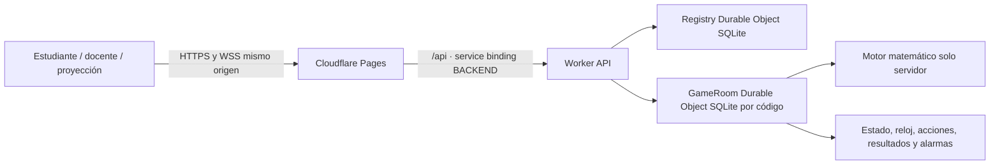

# Arquitectura

En local Vite sustituye a Pages y proxy hacia Wrangler. No se usa Node en producción, Socket.IO, almacenamiento del navegador como autoridad, ni servicios de pago externos al diseño Cloudflare.

## Autoridad y persistencia

Registry reserva códigos y mantiene el índice de salas, las sesiones administrativas revocables y los límites de ingresos/intentos. La reserva se serializa para comprobar unicidad. Cada GameRoom carga su estado con `blockConcurrencyWhile`, procesa mutaciones en una cola exclusiva, persiste antes de emitir resultados y utiliza el almacenamiento SQLite con la API de claves/valores de Durable Objects. La cola evita intercalados durante operaciones `await`; la secuencia de acciones y los conjuntos de objetivos resueltos evitan doble puntuación.

El estado incluye configuración, jugadores, equipos, progreso por entidad competitiva, variantes privadas, tokens de piezas aleatorios y registro acotado a 3000 eventos. La sesión del jugador conserva identificadores recientes y secuencia monotónica; un mensaje viejo con ID fuera de la ventana sigue sin poder reutilizar una secuencia anterior. Los resultados por cámara guardan puntos, errores, pistas y tiempo efectivo.

La alarma se programa para terminar la preparación o cerrar el reloj, y después para la conservación de 30 días. Pausar conserva el tiempo restante y reemplaza la alarma de cierre por la de retención; reanudar programa una nueva fecha límite. El estado persiste al hibernar. No depende de `setInterval` del navegador.

## WebSockets

El servidor usa `acceptWebSocket`, adjuntos serializables y callbacks hibernables. El primer mensaje y las reconexiones llevan un snapshot con versión, secuencia y hora del servidor. Después se envían parches de campos modificados, comparados por destinatario; tras hibernar se permite un nuevo snapshot completo. Cada alumno recibe solo su problema y progreso. El administrador y la proyección se distinguen por una vista autorizada; `view=public` excluye siempre la identidad de estudiante incluso si el navegador tiene cookies.

El cliente solicita un snapshot cada 15 segundos, detecta ausencia de respuesta, reconecta con backoff exponencial y jitter hasta 15 segundos y restaura la secuencia indicada por el servidor. El temporizador visual parte del tiempo restante recibido y avanza con `performance.now()`; el servidor no acepta tiempos del cliente. Una credencial aleatoria de 256 bits se almacena en cookie HttpOnly y solo su hash SHA-256 queda en la sala. Cada nueva pestaña genera una conexión autoritativa que invalida las acciones de la anterior.

## Seguridad

Autenticación docente propia con PBKDF2-SHA-256, sal aleatoria, 100 000 iteraciones y comparación de hash sin retorno anticipado. Contraseña configurada fuera del repositorio. Cookie de sesión aleatoria de ocho horas, HttpOnly, SameSite=Lax, Secure en producción; los tokens se almacenan como hashes y se revocan en logout. Cinco intentos fallidos por IP en 15 minutos; los ingresos tienen un límite por IP. El servidor verifica `Origin` exacto en escrituras y handshake WSS para protección CSRF y de WebSocket.

Mensajes de máximo 4096 bytes, esquemas estrictos, secuencias, rate limit por conexión y tope de conexiones por sala. No hay rutas para escribir puntajes. El Worker borra las cabeceras de rol recibidas y genera su propia autorización antes de llamar al DO. El acceso directo al Worker no elimina la autenticación. El binding de Pages mantiene frontend y API bajo el mismo origen y evita depender de cookies de terceros.

El catálogo y los validadores no se empaquetan en el frontend. Las etiquetas matemáticas y candidatos son públicos; la solución numérica oficial y las correspondencias de piezas permanecen en servidor. KaTeX usa `trust:false`, los nombres se renderizan con React sin HTML de usuario y el CSV neutraliza prefijos de fórmula. Las credenciales nunca se incluyen en eventos ni reportes.

## Límites de esta versión

Instalación de un único administrador; no hay aislamiento entre instituciones. El índice administrativo consulta las salas conservadas y es adecuado para una instalación de aula, no para miles de salas. Las acciones actualizan los campos modificados de la clasificación; no se implementa delta por fila. El SVG y los componentes son livianos, pero no se midieron FPS en teléfonos físicos. Para crecer por encima de 30 alumnos hay que revisar límites, hacer nueva carga y ajustar la persistencia y el fan-out. El rate limit por socket se complementa con tope de conexiones e IP de ingreso; para una publicación de alta exposición conviene añadir controles de borde adaptados al tráfico real.

Fuentes oficiales consultadas: [WebSockets hibernables](https://developers.cloudflare.com/durable-objects/best-practices/websockets/), [almacenamiento SQLite](https://developers.cloudflare.com/durable-objects/best-practices/access-durable-objects-storage/), [configuración Pages](https://developers.cloudflare.com/pages/functions/wrangler-configuration/), [service bindings](https://developers.cloudflare.com/pages/functions/bindings/).
